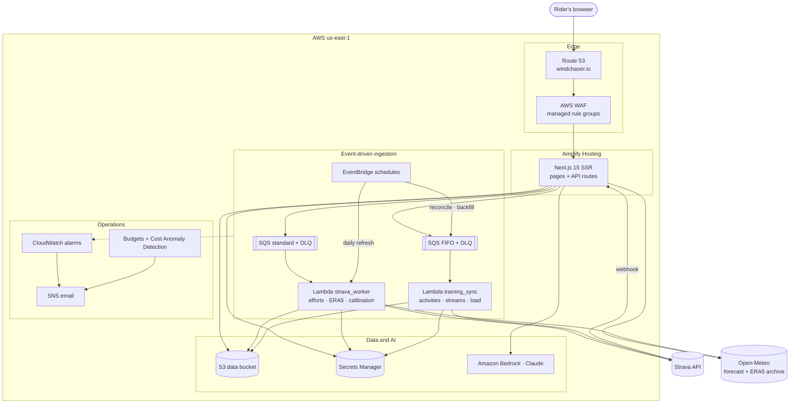
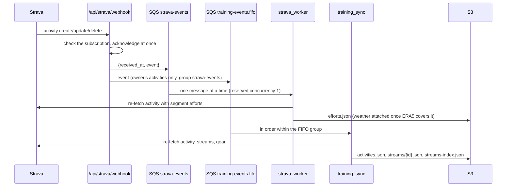
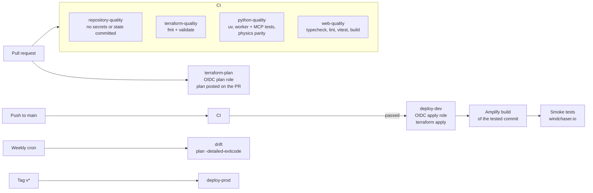

# WindChaser

WindChaser is a cycling application at [windchaser.io](https://windchaser.io).
It does two things for one rider, from their own Strava data:

- **Wind**: predicts, hour by hour for the next week, how long each of the
  rider's Strava segments will take in the forecast wind, and when the rider has
  the best chance of beating their record.
- **Training**: the rider's complete training history, from 2012 onwards, with
  physiological models fitted to the rider. These include training load,
  fitness, VO2max, power and still-air segment times, plus route planning
  against the forecast.

Predictions come from physics and from models fitted to the rider's own history.
Claude (on Amazon Bedrock) writes the explanations and answers questions about
the data by calling tools; it never produces the numbers itself. The whole
system runs serverless on AWS. Every resource is defined in Terraform and
deployed by GitHub Actions with short-lived OIDC credentials.

## Contents

- [Features](#features)
- [Modelling](#modelling)
- [Generative AI](#generative-ai)
- [Architecture](#architecture)
- [Infrastructure as code](#infrastructure-as-code)
- [CI/CD](#cicd)
- [Security, privacy and cost](#security-privacy-and-cost)
- [Repository layout](#repository-layout)
- [Local development](#local-development)
- [Documentation](#documentation)

## Features

### Wind (`/`)

- **Segment timing:** for every starred segment, and for segments discovered
  near the rider's position, predicted time and chance of beating the record
  for each hour of the 7-day forecast.
- **Best window:** the best hour for each segment, ranked, with a scrubber across
  the week and an animated wind field over the map.
- **Segment detail:**
  - the gradient profile;
  - a strip showing tailwind and headwind along the segment;
  - the power the prediction assumes, and its source;
  - the uncertainty;
  - a "why this score" breakdown.
- **Safety gates:** hours with dangerous gusts, sustained wind, rain or
  temperature score zero, whatever the time gain.
- **Briefing:** a short written briefing on the best opportunities, grounded in
  the computed evidence.

### Training (`/training`)

| Page | What it shows |
|---|---|
| Overview | Year-over-year cumulative progress, goals and pace, a GitHub-style activity calendar, and route of the day |
| Activities | Searchable log. Each activity has a map, gradient-coloured elevation profile, 2D and 3D route views, power and heart-rate analysis, and climbs categorised the way Strava does. It also shows this activity's place in its repeated loop and the segment efforts with still-air times |
| Routes / Segments | Most-ridden loops; PR chances for the coming week; still-air leaderboards |
| Saved routes | Every saved Strava route with its profile and climbs, plus a **ride planner**: predicted time for every start hour of the week at a chosen power, and the map coloured by the wind the rider will meet |
| Heatmap | Every outdoor route overlaid on one map |
| Performance | FTP and its history, the power curve and five-point profile, fitness/fatigue/form, Garmin-scale acute and chronic load with load focus, and cycling VO2max with its trend |
| Garage | Bikes and mileage, plus a maintenance log |
| Year in review | A scroll-driven infographic of one year in 11 chapters, ending with a summary card that downloads as a PNG |
| Ask | Owner-only questions in plain language, answered by Claude using tools over the data |

The rider can unlock an **owner mode**, which edits goals, athlete settings and
the maintenance log, and enables Ask.

## Modelling

### Ride-time physics

The forward model (`apps/web/lib/physics.ts`) is mirrored in Python
(`packages/cycling-analytics`). CI checks both against the same golden fixtures.

- **Sections:** a segment is resampled into sections of about 80 m, each with
  its own bearing and gradient (from the elevation profile when available).
- **Speed per section:** found by bisection on the power balance

  `P·η = v·(½·ρ·CdA·v_air·|v_air| + Crr·m·g·cos θ + m·g·sin θ)`

  where `v_air` includes the wind component along the section at rider
  height. The 10 m wind is reduced with a logarithmic profile.
- **Air density** uses temperature, pressure and humidity (Tetens).
- **Ride time** is the **sum of section times**, never one average wind
  applied to the whole segment.

### Calibration on the rider's own history

`packages/cycling-analytics/calibration.py` builds `calibration.json` from every
segment effort the rider has recorded. Each effort is joined to the hour of the
**ERA5 reanalysis** it was ridden in, from the Open-Meteo archive. Efforts
without weather are left out rather than treated as calm. Three fits are made:

1. **Mass and CdA:** fitted by coordinate search over efforts where both time and
   measured power are known.
2. **Rider model:** `P(t, grade) = CP + W′/t + k·grade`.
   - Weighted least squares on measured power, with one 2.5σ trimming pass.
   - Samples are age-weighted with a 2-year half-life.
   - The grade term was added because the residuals tracked gradient
     (r = +0.49).
3. **Per-segment power:** for segments with enough attempts, the power that best
   reproduces all of them in their real weather.

The Lambda worker rebuilds the calibration on every scheduled run, so new rides
improve predictions without anyone running a script.

**Backtests** (`scripts/evaluate_*.py`):
- `evaluate_calibration.py`: time-ordered per-segment splits;
- `evaluate_rider_model.py`: leave-one-segment-out;
- `evaluate_time_forward.py`: rolling origin.

| Predictor | Test | Mean absolute error |
|---|---|---|
| Still-air fit to the single record (baseline) | Leave one segment out | 98 s, biased 96 s optimistic |
| Rider model (CP, W′, grade) | Leave one segment out | 83 s, bias −3 s |
| Per-segment fit in real weather, average gradient | Time-ordered, per segment | 72.5 s |
| Per-segment fit in real weather, with the elevation profile | Time-ordered, per segment | **52.3 s** |

The rider model covers segments with no history of their own; the per-segment
fits apply once a segment has enough attempts.

The half-life was chosen from the time-forward test: 2 years is the knee
between accuracy on new segments and on future rides.

### Prediction, uncertainty and score

For each segment and forecast hour:
- **Power:** taken from the best available evidence, in this order:
  1. the per-segment fit;
  2. the rider model, solved by fixed point for that segment's duration and
     gradient;
  3. the single-record fit.
- **Uncertainty:** wind, model and effort terms combined in quadrature.
- **Chance of a record:** `P(beat) = Φ((target − t̂)/σ)`.
- **Score:** chance and margin, minus penalties for rain, gusts and comfort.
  Weights are versioned, and the safety gates above zero the score.

### Still-air segment times

Each effort's time is restated as if ridden in still air:
- solve the steady power that reproduces its moving time in its ERA5 wind and
  air density;
- ride that power again in calm air at standard density.

Validation over 660 efforts:

| Check | Result |
|---|---|
| Spread across efforts on the same segment | Narrower on 17 of 23 segments |
| Implied power vs the power meter (544 efforts) | r² 0.713, against 0.683 without the wind term |
| Wind scaled up 1.5× or 2× | Every measure gets worse |

Segments where the adjustment fits measured power worse than raw time, mostly
sheltered roads, are flagged in the interface.

### Training metrics

- **FTP:** `min(CP, 0.95 × best 20 min)`.
  - CP comes from a linear work–time fit (`W = CP·t + W′`) on 3–20 minute
    mean-maximal efforts over 90 days.
  - It is tracked weekly.
- **TSS:** from normalised power, computed at 1 Hz with pauses removed.
- **Heart-rate-only activities:** scored with Banister TRIMP, scaled to TSS by
  the rider's own TSS/TRIMP ratio.
- **Fitness/fatigue/form:** 42- and 7-day exponentially weighted averages.
- **Repeated loops:** rides matched by GPS track, direction-aware.
  - Same start and finish within 500 m, distance within 10%.
  - At least 85% of resampled points within 150 m of the other track, checked
    both ways.

### Garmin-scale training load and VO2max

Garmin computes training load only for activities recorded on a Garmin device.
WindChaser recomputes it for every activity. Its models were fitted to the
rider's Garmin numbers (per-activity `activityTrainingLoad`, training-effect
labels and per-ride VO2max from the FIT files), then evaluated on the newest 20%
of activities, held out by date.

| Model | Input | Hold-out |
|---|---|---|
| EPOC accumulation, `dE/dt = A·x^P − E/τ` with x the fraction of heart-rate reserve; load = peak E | Second-by-second heart rate | MAE 13.5, R² 0.91 (a plain TRIMP sum: MAE 19.4) |
| Log-linear summary model | Average and max heart rate, duration, sport | MAE 17.3, R² 0.83 |
| Power-law model | TSS against a fixed reference | MAE 17.1, R² 0.85 |
| Multinomial logistic load focus (low aerobic / high aerobic / anaerobic) | Heart-rate reserve, duration, sport | 85% accuracy (81% baseline) |

- **Acute and chronic load:** 7- and 28-day exponentially weighted load, with
  Garmin's ratio bands.
- **VO2max:**
  1. take steady heart-rate/power stretches;
  2. extrapolate power to maximum heart rate;
  3. convert with the ACSM cycling equation;
  4. report the median over 6 weeks.

  It is within about 1.4 ml/kg/min of Garmin's per-ride values on held-out
  rides.
- **Heart-rate anchors:** max heart rate is derived from the data (the 99th
  percentile of activity maxima), and the models were fitted at those anchors,
  so nothing needs configuring.

### Route forecasting

**Ride planner:** the saved-route planner splits a route into up to 300
sections. Each section meets the forecast for the moment the rider is expected
to reach it, interpolated between hours and taken from the nearest 0.1° forecast
cell.

**Route of the day** ranks every saved route by the percentage of time saved
against calm air at its best daylight start, with penalties for rain, darkness
and temperature.
- Forecast cells are deduplicated across routes and fetched in batches, so 141
  routes cost 4 forecast requests.
- Sections are cached by the routes' ETag.

**PR chances** run the same evaluation for every segment with history and list
the hours when the predicted time comes within reach of the record. Each comes
with a probability, and a confidence note from the model's backtest error.

## Generative AI

**Decision rule:** deterministic code computes every number; the language model
only explains and retrieves.
([ADR-0002](docs/decisions/0002-deterministic-alert-core.md))

- **Briefing** (`lib/server/briefing.ts`):
  - Claude through Amazon Bedrock, falling back to the Anthropic API, then to a
    deterministic template.
  - The prompt carries only the computed evidence for the top five
    opportunities, and is told never to state a number outside it.
  - Responses are cached by a hash of that evidence.
- **Ask** (`lib/training/ask/`): a streaming tool-use agent on Claude Opus 5.5
  (Bedrock first, then the Anthropic API).
  - **Tools:** seven typed, schema-validated tools over the training data —
    activity search, totals with year-over-year comparison, goals, performance,
    gear and maintenance, segment efforts, and activity detail.
  - **Inspectable:** every call is shown in the answer's trace.
  - **Prompt caching:** a frozen system prompt and tool list in a fixed order.
  - **Limits:** 8 tool rounds, a 120 s budget, question and history size limits,
    per-session and per-instance rate limits, and owner-only access.
- **MCP server** (`mcp/`): a Model Context Protocol server over stdio
  (JSON-RPC 2.0, standard library only). It lets any MCP client predict segment
  times, find the best window, compare segments and explain a prediction
  section by section, using the same physics and calibration.

## Architecture



### From a ride to the page



- **Webhook bodies are never trusted:** both workers re-fetch every event from
  the Strava API.
- **No write races:** the two workers write disjoint S3 keys, and each
  serialises its own writes (reserved concurrency 1, or one FIFO message group).
- **Shared Strava limits:**
  - both workers share one Strava application, and discretionary work stops at
    80% of the daily read allowance, read from Strava's rate-limit headers;
  - a rotated refresh token is merged back into the shared secret after
    re-reading it, so neither worker locks the other out.
- **Fast reads:** the web tier serves S3 JSON through an ETag-validated
  in-memory cache, and browsers revalidate with `If-None-Match`.

### AWS services

| Service | Use |
|---|---|
| Amplify Hosting (`WEB_COMPUTE`) | Next.js server rendering and API routes; builds from `main` with `amplify.yml` |
| Lambda (Python 3.12) | `strava_worker`: 2 GB, x86_64, reserved concurrency 1. `training_sync`: 256 MB, arm64 |
| SQS | A standard queue and a FIFO queue, each with a dead-letter queue and SSE |
| EventBridge | Daily calibration refresh, daily reconciliation, hourly streams backfill |
| S3 | Versioned application data bucket; Terraform state bucket |
| Secrets Manager | Strava credentials (rotated by the workers) and owner-mode secrets |
| Amazon Bedrock | Claude for the briefing and Ask, through the Bedrock Mantle endpoint |
| AWS WAF | IP reputation, common and known-bad-inputs managed rule groups; per-IP rate limits on owner sign-in, the briefing and Ask; a narrow exception for the Strava webhook |
| Route 53 + ACM | Hosted zone and certificates for `windchaser.io` through the Amplify domain association |
| CloudWatch + SNS | Worker error, dead-letter and queue-age alarms, emailed |
| Budgets + Cost Anomaly Detection | A monthly budget on the application's cost tag, and anomaly alerts |
| IAM + OIDC | GitHub Actions roles with no long-lived keys; object-level S3 grants per worker |

## Infrastructure as code

All AWS resources are declared in Terraform under `infrastructure/terraform`.

```text
bootstrap/          applied once by hand: state bucket, GitHub OIDC provider, CI roles
modules/
  observability-baseline/   SNS alerts, budget, cost anomaly monitor
  dns/                      Route 53 hosted zone
  web/                      Amplify app and branch, data bucket, secrets, Bedrock access, domain
  strava-ingestion/         standard queue + DLQ, strava_worker Lambda, schedule, alarms
  training-sync/            FIFO queue + DLQ, training_sync Lambda, schedules, alarms
  web-firewall/             WAFv2 web ACL (adopted from Amplify with an import block)
environments/
  dev/                      the live environment at windchaser.io
  prod/                     reserved; empty
```

- **Remote state** in S3 with native lock files (`use_lockfile`), versioning,
  encryption and a TLS-only policy.
- **CI roles, created by the bootstrap:**
  - a read-only **plan** role, trusted for pull requests and `main`;
  - one **apply** role per GitHub environment, each assumable only from that
    environment.
  - Apply roles can create IAM only under the `windchaser-*` prefix, and are
    denied any change to the bootstrap roles, the OIDC provider or the state
    bucket's protection.
- **Lambda packages** are zipped from source by Terraform. A Python change
  ships through `terraform apply`, and the web app through an Amplify build
  started by the deploy workflow.
- **Existing resources** (the Amplify-created web ACL, a connected Amplify
  branch) are adopted with `import` blocks rather than recreated.
- **Runtime configuration:** Amplify does not expose environment variables to
  the server runtime. `amplify.yml` therefore writes an explicit allowlist into
  `.env.production` at build time. It carries names and ARNs only; secret
  values stay in Secrets Manager.

## CI/CD



| Workflow | Trigger | What it does |
|---|---|---|
| `ci.yml` | Pull requests, pushes to `main` | Rejects committed `.env`, state, plans and keys; checks Terraform formatting and validates every root; runs the Python suites (Strava worker, training sync, calibration, MCP protocol) and a TypeScript/Python physics parity check; typechecks, lints, tests (vitest) and builds the web app |
| `terraform-plan.yml` | Pull requests touching Terraform | Assumes the plan role through OIDC, plans against the dev backend, and posts the plan as a comment on the pull request |
| `deploy-dev.yml` | CI passing on `main` | Assumes the development apply role through OIDC and runs `terraform apply`; starts the Amplify build of the tested commit and waits for it; smoke-tests windchaser.io (health, both sections render with data, key APIs answer) |
| `deploy-prod.yml` | Tags `v*` | The same against production |
| `drift.yml` | Mondays | `terraform plan -detailed-exitcode` to detect changes made outside Terraform |

Nothing deploys unless CI passed on that commit. Amplify's auto-build is off
for this reason: the deploy workflow starts each build after Terraform has
applied, then smoke-tests the live site. Credentials are short-lived OIDC
sessions only. Role ARNs and the state bucket are GitHub variables, and the
alert email address is a GitHub secret.

## Security, privacy and cost

- **Owner mode** is the only write path from the browser.
  - A passphrase is exchanged for an HMAC-signed, `HttpOnly`,
    `SameSite=Strict` cookie that lasts 8 hours.
  - Every state-changing request must also pass a same-origin check
    (`Sec-Fetch-Site`).
  - S3 writes are conditional on the version read, and IAM allows the web
    runtime to write only two keys.
- **Rate limits:**
  - **WAF, per client address:** owner sign-in, the public briefing and Ask.
  - **App, per compute instance:** sign-in attempts are capped, and briefing
    model calls are capped (after that a deterministic template answers).
  - The public health endpoint reports only whether configuration resolved.
- **Location privacy:**
  - every response that carries coordinates hides the first and last 500 m of
    each route;
  - "Only You" activities are never stored;
  - Ask's tools never return coordinates;
  - virtual rides are kept off the heatmap.
- **Strava webhook:** the verify token is compared in constant time, unknown
  subscriptions are acknowledged and dropped, and event payloads are re-fetched
  rather than trusted.
- **Secrets:** Terraform creates only the containers; values are written out of
  band. No long-lived AWS keys exist anywhere, and CI fails if secret material is
  committed.
- **Cost:**
  - scale-to-zero services throughout;
  - a monthly budget with 50% / 90% / forecast-100% alerts;
  - cost anomaly detection;
  - the briefing is cached per evidence set;
  - Ask is owner-only and rate-limited.

## Repository layout

```text
apps/web/                         Next.js app: wind view, Training section, API routes
  lib/physics.ts                  ride-time physics, uncertainty and scoring
  lib/server/                     forecast, calibration, Strava client, briefing
  lib/training/                   data layer, metrics, loops, route forecasting, Ask agent
packages/cycling-analytics/       Python physics, rider model and calibration
services/strava_worker/           Lambda: segment efforts, ERA5 weather, calibration
services/training_sync/           Lambda: activities, streams, gear, saved routes, load
mcp/                              MCP server over stdio
scripts/                          offline data pipeline, evaluations, test suites
infrastructure/terraform/         bootstrap, modules, environments
.github/workflows/                CI, plan, deploy, drift
docs/                             architecture notes and decision records
```

## Local development

**Python** is managed with [uv](https://docs.astral.sh/uv/) (Python 3.12, standard
library only at runtime):

```bash
uv python install && uv sync --locked --all-groups
uv run python scripts/test_strava_worker.py
uv run python scripts/test_training_sync.py
uv run python scripts/test_calibration.py
uv run python scripts/test_mcp_server.py
```

**Web** (Node 22):

```bash
cd apps/web
npm ci
npm run dev          # http://localhost:3000
npm test             # vitest
npm run typecheck && npm run lint && npm run build
```

- **Wind view:** runs from the fixtures in `apps/web/fixtures`, produced by the
  offline pipeline (`scripts/fetch_strava_fixtures.py` →
  `fetch_effort_history.py` → `build_calibration.py` → `evaluate_*.py`).
- **Training section:** reads the data bucket named by `APP_DATA_BUCKET`, given
  AWS credentials.
- **Configuration:** `.env.example` lists the local settings.

**Terraform:**

```bash
make terraform-fmt
make terraform-validate
```

## Documentation

- [AWS architecture](docs/architecture/AWS_ARCHITECTURE.md)
- [Terraform and CI/CD](docs/architecture/TERRAFORM_AND_CICD.md)
- [Training integration](docs/architecture/TRAINING_INTEGRATION.md)
- [Cost strategy](docs/architecture/COST_STRATEGY.md)
- [Architecture decision records](docs/decisions/README.md)
- [MCP server](mcp/README.md)
