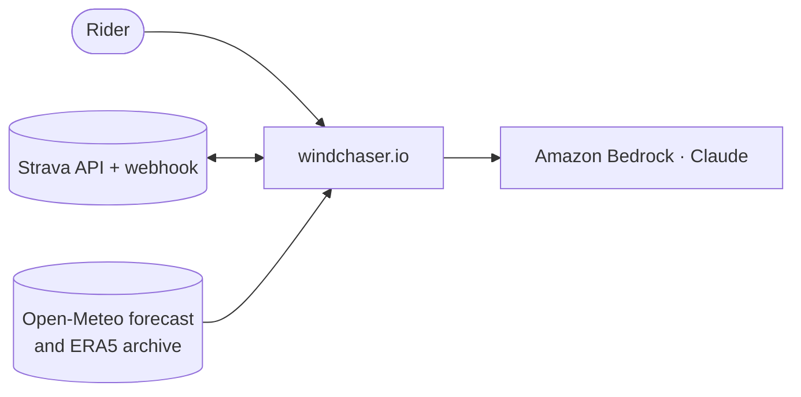
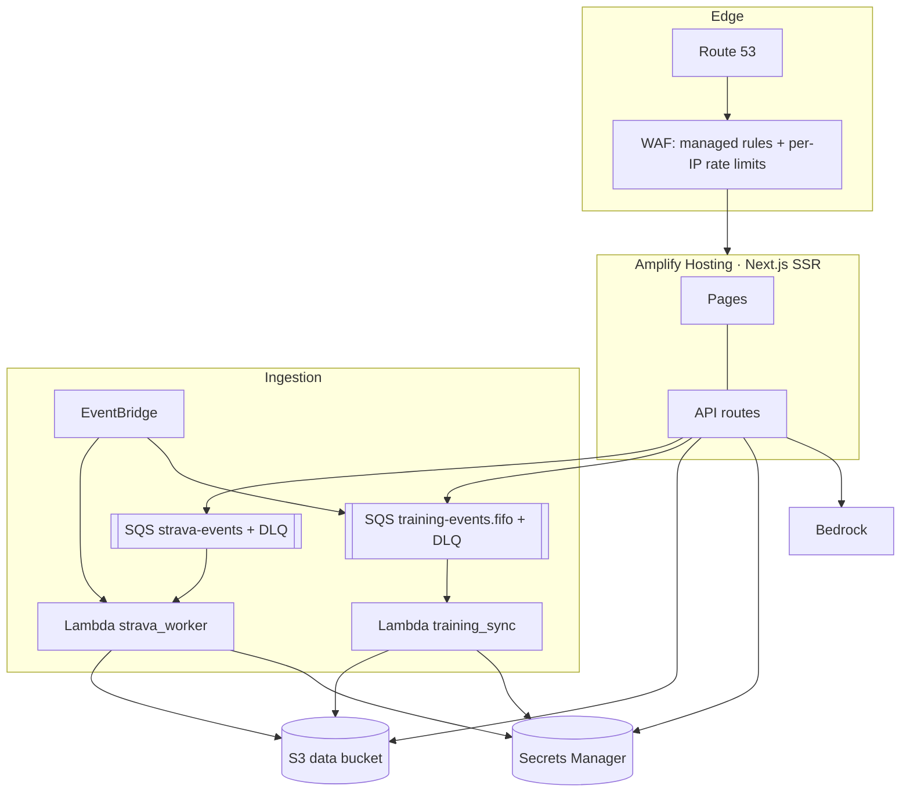

# AWS Architecture

## Design intent

- **Serverless and scale-to-zero:** nothing runs while nobody is riding or reading.
- **Numbers from code, words from the model:** forecasts, predictions and
  training metrics come from deterministic code and fitted models. Claude explains
  and retrieves; it never supplies a number
  ([ADR-0002](../decisions/0002-deterministic-alert-core.md)).
- **One Strava application:** one webhook, one rotating refresh token and one rate
  limit, shared by two workers that write disjoint data
  ([ADR-0004](../decisions/0004-merge-my-strava.md)).
- **Degrade, don't fail:** every external dependency has a fallback that keeps the
  site useful.

## Context

## Components

| Component | Role |
|---|---|
| Amplify Hosting (`WEB_COMPUTE`) | Renders the pages and serves the API routes. Reads S3 JSON through an ETag-validated in-memory cache. |
| `strava_worker` (Lambda, 2 GB, reserved concurrency 1) | Segment efforts: ingests webhook events, counts every segment effort into `segment-usage.json`, re-reads tracked segments, backfills the most ridden untracked one, attaches ERA5 weather once the archive covers an effort, rebuilds `calibration.json` daily. Object-level grants on its four keys only. |
| `training_sync` (Lambda, arm64, 256 MB) | Activities, detail streams, gear and saved routes; computes exercise load and the VO2max signal from full-resolution streams. |
| SQS standard and FIFO | Absorb webhook bursts and retries. The FIFO group `strava-events` serialises training writes; reserved concurrency serialises `strava_worker`'s. |
| EventBridge | Daily calibration refresh; daily reconciliation and hourly streams backfill for training. |
| S3 | Versioned application data: one JSON object per dataset plus per-activity streams and per-route profiles. |
| Secrets Manager | `windchaser/{env}/strava` (rotated by both workers) and `windchaser/{env}/web` (owner mode). |
| Bedrock | The wind briefing and the Ask agent, through the Bedrock Mantle endpoint. |
| CloudWatch, SNS, Budgets | Error, dead-letter and queue-age alarms; monthly budget and cost anomaly alerts; all emailed. |

## Request paths

### Wind view

1. The browser asks for its position, then `GET /api/opportunities`.
2. The route resolves the segments and fetches the 7-day forecast once per 0.1°
   cell (Open-Meteo, cached 30 minutes).
   - **Segments:** starred segments, the tracked segments with effort history
     in `efforts.json` (with the rider's record and still-air times), and
     segments discovered around the rider's position, merged so each appears
     once with every source it came from. `segment-usage.json` adds how often
     and how lately each is ridden; ranking and region order lean on it.
   - **Discovery failures** are logged with the error's class, Strava's status
     and message; a 401 or 403 stands discovery down for six hours, and the
     saved bundle's discoveries near the same place stand in, noted quietly on
     the page.
   - **Calibration:** applied from `calibration.json`.
   - **Fallback:** if Strava or the forecast is unavailable, the response uses
     the saved bundle in S3, and says so.
3. The browser evaluates every segment against every forecast hour with the
   physics model, ranks the windows and picks the week's PR chances from the
   same evaluations.
   - **Routes mode** (`/?mode=routes`) instead calls
     `/api/training/route-ranking` and, for the route picked,
     `/api/training/saved-routes/{id}` and `/api/training/route-forecast`.
4. `POST /api/briefing` sends the evidence: the top five windows with their
   still-air facts, the week's near misses and the best saved route for the
   day, all computed in the browser and kept well under Amplify's 6 KB body
   limit.
   - Claude writes the briefing, cached by a hash of that evidence.
   - If the model fails or the per-instance call budget is spent, a
     deterministic template answers instead.

### Ride to data

1. Strava posts to `/api/strava/webhook`. The route checks the subscription and
   acknowledges at once.
2. It enqueues the event on the standard queue, and the owner's activity events
   on the FIFO queue.
3. The workers process the events.
   - Both re-fetch the event from the Strava API rather than trusting the body.
   - Each writes only its own S3 keys.
   - Discretionary work stops at 80% of the daily read allowance shared by both.

### Training pages

Server components read the S3 JSON and compute metrics. Responses carrying
coordinates hide the first and last 500 m of every route.

### Owner writes and Ask

- **Owner mode:** a passphrase is exchanged for an HMAC-signed `HttpOnly`,
  `SameSite=Strict` cookie. Writes also require `Sec-Fetch-Site: same-origin`
  and are conditional on the version read.
- **Ask:** streams a Claude tool-use loop as server-sent events.
  - Tools are read-only.
  - Each answer is capped at 8 rounds and 120 s.
  - Per-session and per-instance rate limits apply.

## Environments

- **dev:** the live environment at windchaser.io, in one AWS account.
  - Every resource, IAM role and budget is named and tagged per environment.
- **prod:** a separate Terraform root, apply role and protected GitHub environment
  exist, but it declares no resources yet.

## Boundaries and degradation

| Failure | What still works |
|---|---|
| Strava down or rate-limited | Saved segment bundle and stored history; webhook events wait in SQS and retry. |
| Forecast unavailable for a cell | That cell falls back to the saved bundle; other cells stay live. |
| Bedrock and the Anthropic API unavailable | Template briefing; Ask reports that it is unavailable. |
| A worker keeps failing | Messages move to the dead-letter queue after 5 attempts and an alarm fires; nothing is written from a failed run. |
| ERA5 not yet covering an effort | The effort is held without weather and excluded from fitting until the archive catches up. |

