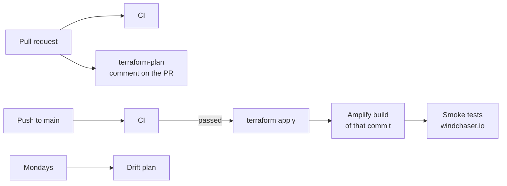

# Terraform and CI/CD

## Rules

1. Terraform declares every persistent AWS resource. Resources AWS created on its
   own (the Amplify web ACL, a console-connected Amplify branch) are adopted with
   `import` blocks, not left implicit.
2. Deployment happens through GitHub Actions, not from a laptop.
3. GitHub authenticates to AWS with OIDC; there are no long-lived AWS keys.
4. Nothing deploys unless CI passed on that exact commit.
5. Plans are visible on pull requests; drift is checked weekly.
6. Secret values never pass through Terraform. It creates the secret
   containers; values are written out of band and referenced by ARN.

## Layout

```text
infrastructure/terraform/
├── bootstrap/                 state bucket, GitHub OIDC provider, CI roles (applied once by hand)
├── environments/
│   ├── dev/                   the live environment
│   └── prod/                  reserved; no resources yet
└── modules/
    ├── observability-baseline/   SNS alerts, budget, cost anomaly monitor
    ├── dns/                      Route 53 hosted zone
    ├── web/                      Amplify app and branch, data bucket, secrets, Bedrock access, domain
    ├── strava-ingestion/         standard queue + DLQ, strava_worker, schedule, alarms
    ├── training-sync/            FIFO queue + DLQ, training_sync, schedules, alarms
    └── web-firewall/             WAFv2 web ACL: managed rule groups and per-IP rate limits
```

## State

- **S3 backend** with native lock files (`use_lockfile`).
- **The state bucket:** versioned, AES-256 encrypted, public access blocked,
  TLS-only, and protected from deletion.
- **One state key per environment.**
- **State access:** only the CI roles and administrators.

## Identity

The bootstrap creates the GitHub OIDC provider and three roles:

| Role | Trusted for | Permissions |
|---|---|---|
| `windchaser-ci-plan` | Pull requests, `main`, both GitHub environments | `ReadOnlyAccess` plus state access |
| `windchaser-ci-apply-development` | The `development` environment only | `PowerUserAccess`, IAM limited to `windchaser-*` |
| `windchaser-ci-apply-production` | The `production` environment only | The same, for production |

Guardrails stop either apply role from changing the bootstrap roles, the OIDC
provider or the state bucket's protection.

## Artifacts

- **Lambda packages** are zipped from `services/` and
  `packages/cycling-analytics` by Terraform's `archive_file`. A Python change
  ships with `terraform apply`.
- **The web app** is built by Amplify from the commit CI tested, using
  `amplify.yml`. Amplify does not expose environment variables to the
  server runtime, so the build writes an allowlist of them into
  `.env.production` (names and ARNs only).

## Workflows



| Workflow | Trigger | Steps |
|---|---|---|
| `ci.yml` | Pull requests and pushes to `main` | Rejects committed `.env`, state, plans and keys; checks that the core docs exist; `terraform fmt` and `validate` on every root; Python suites and a TypeScript/Python physics parity check; web typecheck, lint, vitest and build |
| `terraform-plan.yml` | Pull requests touching Terraform | Assumes the plan role, plans against the dev backend, and posts the plan as one comment updated on each push |
| `deploy-dev.yml` | CI completing on `main` (only if it passed), or manual | Assumes the development apply role and runs `terraform apply`. Then it starts the Amplify build of the tested commit and waits for it, and smoke-tests windchaser.io (`scripts/smoke_test.sh`: health, both sections render with data, heatmap and performance APIs answer) |
| `deploy-prod.yml` | Tags `v*`, or manual | The same apply against production, which has no resources yet |
| `drift.yml` | Mondays, or manual | `terraform plan -detailed-exitcode` with the plan role; a non-zero exit flags changes made outside Terraform |

Amplify's auto-build is off for dev (`enable_auto_build = false`). Builds
start only from the deploy workflow, so a web change that failed CI never ships.

## Rollback

- **Code:** revert the commit on `main`. CI, apply, build and the smoke tests
  run again for the reverted state.
- **Web:** Amplify keeps previous builds, so an earlier one can be redeployed
  while a revert is in review.
- **Data:** application data is versioned in S3. Earlier versions of any JSON
  object can be restored.
- **Never** edit state or run destructive resets; Terraform rollback means
  applying a reviewed earlier configuration.
